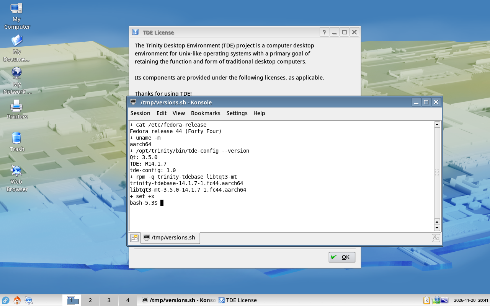
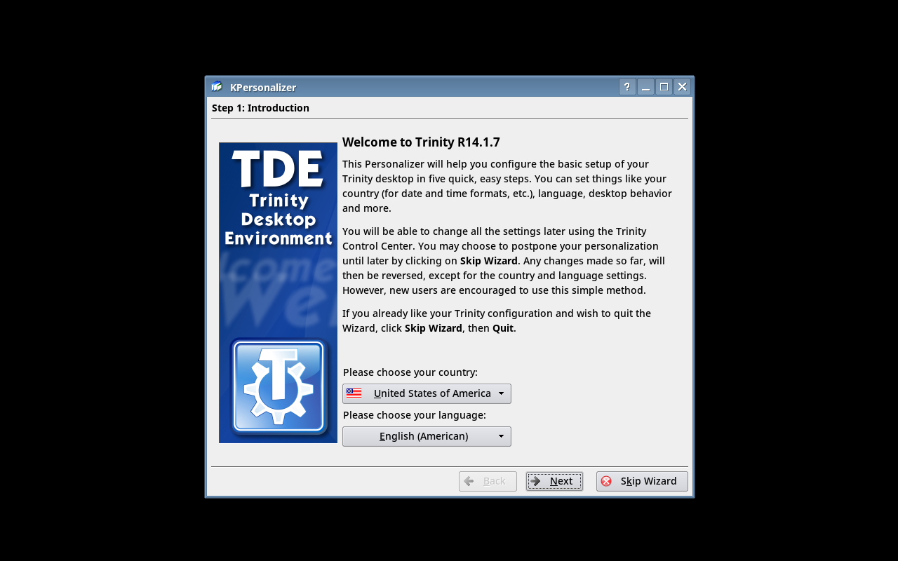

# Fedora Trinity ARM64

The **Trinity Desktop Environment** (TDE R14.1.x, the maintained continuation of KDE 3.5) rebuilt for
**Fedora 44 on ARM64/aarch64**, with a working X11 session and a kickstart for a test remix image.
It was developed inside a Parallels VM on Apple Silicon.

The Trinity project publishes Fedora packages for x86_64 only. This repository is the build pipeline that
turns its official Fedora 44 source packages into aarch64 RPMs, plus the notes on everything that had to
change along the way.

| | |
| --- | --- |
|  |  |
| *Trinity R14.1.7 on Fedora 44 aarch64, rebuilt 20 November 2026* | *The first-run wizard from the same rebuild* |

## Status: a July 2026 project, re-checked in November 2026

- **Built 6 and 7 July 2026** against TDE R14.1.6. Everything under [docs/](docs/) dated July describes that work.
- **Re-checked 20 November 2026** against TDE R14.1.7, the release now on the mirror (R14.1.6 sources are no
  longer published). All 14 source packages verified, built and ran a desktop session. See
  [docs/r14.1.7-rebuild-2026-11-20.md](docs/r14.1.7-rebuild-2026-11-20.md).
- **Not actively maintained.** The package versions are pinned in the scripts, so expect them to drift again
  when Trinity or Fedora moves on. The remix image has not been rebuilt since July.

Stages:

- [x] Stage 1: system discovery ([docs/system-inventory.md](docs/system-inventory.md))
- [x] Stage 2: build environment bootstrap (`scripts/00-bootstrap-fedora-arm64.sh`)
- [x] Stage 3: package source decision: rebuild the official TDE f44 SRPMs for aarch64
      ([docs/package-source-decision.md](docs/package-source-decision.md))
- [x] Stage 4: TDE aarch64 package builds: all 14 SRPMs rebuilt into a local repo
- [x] Stage 5: working Trinity X11 session (lightdm, then TDE login; kicker, kdesktop, twin, ksmserver and konsole verified)
- [x] Stage 6: Parallels ARM64 notes ([docs/parallels-arm64-notes.md](docs/parallels-arm64-notes.md))
- [x] Stage 7: validation, including a reboot-to-greeter cycle ([docs/validation-results.md](docs/validation-results.md))
- [x] Stage 8: remix disk image builds (`scripts/40-build-remix-image.sh` and `kickstart/`). **Test only**, see
      [docs/remix-build-plan.md](docs/remix-build-plan.md)

## What is and is not here

- **Here:** build scripts, the mock configuration they generate, the kickstart, notes and screenshots, and
  copies of the Trinity project's two public RPM signing keys.
- **Not here:** binary RPMs or disk images. The packages this produces are unsigned local rebuilds, so they are
  not distributed. Building them takes about 15 minutes on a 10-core Apple Silicon Mac.
- The source packages are downloaded from the official Trinity mirror by `scripts/10` and checked against the
  project's signing keys before anything is built.

## Architecture decisions

1. **X11 first.** The milestone is a reliable Xorg and Trinity session on Fedora ARM64. No Wayland porting.
2. **Wayland later, hybrid.** A Labwc/wlroots compositor with Trinity shell integration and XWayland for TDE apps
   is a later track; TQt on Wayland is not a prerequisite.
3. **RPM everything.** TDE is rebuilt from upstream's official f44 SRPMs into a local aarch64 repo (`repo/`) and
   installed with dnf. Nothing is installed under `/usr/local`.

## Build it

You need a Fedora 44 aarch64 machine or VM. The scripts assume a build user called `trinity` (in the `mock`
group, with sudo) and this repository checked out at `/home/trinity/fedora-trinity-arm64`.

```sh
bash scripts/00-bootstrap-fedora-arm64.sh               # build tools and the X11 runtime set
bash scripts/10-enable-trinity-repos-or-build.sh        # as trinity: SRPMs, signing keys, local repo
sudo bash scripts/12-root-setup-mock.sh                 # as root: rpm keys and the mock config
bash scripts/11-build-tde-chain.sh                      # as trinity: the mock chain build
sudo bash scripts/20-install-trinity-core.sh            # as root: dnf install from repo/
sudo bash scripts/30-configure-trinity-session.sh       # as root: lightdm and the Trinity session
sudo bash scripts/90-validate-tde-session.sh            # as root: PASS/FAIL checks
```

`scripts/40-build-remix-image.sh` builds the test disk image with livemedia-creator. Read
[docs/remix-build-plan.md](docs/remix-build-plan.md) first: the kickstart creates a test user with a
documented throwaway password, and the image must not be redistributed as it stands.

## What had to change for Fedora 44 aarch64

The TDE specs assume the Trinity project's own build farm. All of these are encoded in `scripts/12`:

- `brp-remove-la-files` is disabled. TDE specs package `.la` files and TDE's autotools consume them.
- `gcc` and `gcc-c++` are preinstalled in the chroot. Some TDE specs (trinity-tde-cmake) omit the compiler
  BuildRequires.
- `%__cmake_in_source_build 1`. TDE specs use the legacy `cd build; %cmake ..` pattern, and Fedora's `-S`/`-B`
  injection strands the Makefiles.
- `%_cmake_generator "Unix Makefiles"`. Fedora 44 defaults `%cmake` to Ninja; TDE specs run plain `make`.
- `trinity-tde-cmake` is added to the chain. Every TDE package after TQt needs it without declaring it.
- `%__brp_check_rpaths` is disabled. TDE installs under `/opt/trinity` with an RPATH that Fedora's check rejects.
- CMake policy CMP0109 defaults to NEW, so tdelibs accepts Fedora's executable-but-unreadable utempter helper.
- Debug subpackages are disabled, because an empty debug source list hard-fails some packages under ccache.
- **New for R14.1.7:** `%tde_version 14.1.7` is defined. The R14.1.7 source packages carry the 14.1.7 tarball,
  but each spec still falls back to 14.1.6 unless the build farm defines the version.

The full history, including the failures that led to each of these, is in [CHANGELOG.md](CHANGELOG.md).

## Layout

```
docs/       inventory, decisions, session startup, validation, remix plan, the November re-check
scripts/    numbered, idempotent stage scripts (00, 10, 11, 12, 20, 30, 40, 90)
rpmbuild/   the Trinity project's public RPM signing keys; downloaded SRPMs go in rpmbuild/srpms/ (ignored)
kickstart/  remix kickstart (Stage 8)
repo/       build output: the local aarch64 RPM repo (ignored)
logs/       build output: stage logs and per-package mock logs (ignored)
```

## Host and guest workflow (Parallels)

The original setup kept the canonical tree on the Mac and an execution copy in the guest, synced with:

```sh
rsync -a --exclude .DS_Store ./ fedora-trinity:fedora-trinity-arm64/
```

User-level commands ran over `ssh fedora-trinity`; root commands ran with
`prlctl exec Fedora_Trinity /usr/bin/bash /home/trinity/fedora-trinity-arm64/scripts/<script>`.
Nothing in the scripts depends on Parallels; the November re-check ran in a Lima VM.

## Credits

The Trinity Desktop Environment is the work of the [TDE project](https://www.trinitydesktop.org/). The source
packages, spec files and signing keys are theirs. This repository is not affiliated with or endorsed by the
TDE project or the Fedora Project.
